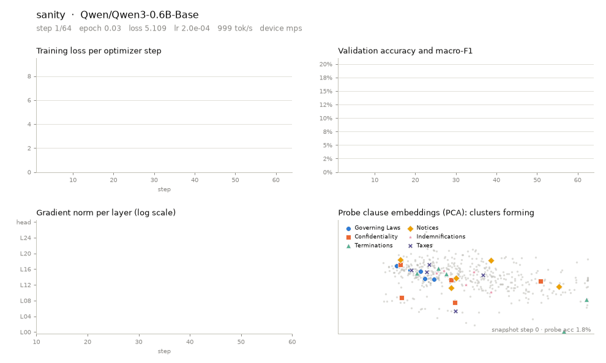

# Contract Clause Classifier

Fine-tune a ~0.6B language model (Qwen3-0.6B) to recognise **clause types in contracts**, then serve it through an **OpenAI-compatible FastAPI**.

Give it a contract (text, PDF or DOCX). It splits the contract into provisions, classifies each one into one of **100 clause types**, and returns calibrated confidences:

```json
{
  "document": [
    {"name": "Governing Laws", "confidence": 0.97},
    {"name": "Confidentiality", "confidence": 0.94},
    {"name": "Terminations", "confidence": 0.88}
  ],
  "clauses": [
    {"index": 4, "text": "4. Confidentiality. Each party shall hold ...",
     "predictions": [{"name": "Confidentiality", "confidence": 0.94}]}
  ],
  "num_clauses": 13
}
```

Training runs on **any machine** (Apple Silicon MPS, NVIDIA CUDA or CPU, auto-detected). While it trains, a **live dashboard** prints in the terminal and **every step is recorded** to disk so the run can be replayed as charts, a GIF or a video later.



---

## Contents

1. [How it works](#how-it-works)
2. [Requirements](#requirements)
3. [Setup](#setup)
4. [Run the full pipeline](#run-the-full-pipeline)
5. [Training in detail](#training-in-detail)
6. [Training telemetry and visualisation](#training-telemetry-and-visualisation)
7. [Evaluation](#evaluation)
8. [Predict from the command line](#predict-from-the-command-line)
9. [API (FastAPI, OpenAI-compatible)](#api-fastapi-openai-compatible)
10. [Docker](#docker)
11. [Project layout](#project-layout)
12. [Configuration reference](#configuration-reference)
13. [Testing](#testing)
14. [Troubleshooting](#troubleshooting)
15. [Pinned versions](#pinned-versions)

---

## How it works

```
contract (.txt / .pdf / .docx, or the user message of a chat request)
   │  segment.py   split into provisions (numbered sections, headings, paragraphs)
   ▼
[provision 1 … provision n]
   │  Qwen3-0.6B-Base + LoRA adapters + 100-way classification head
   │  (last-token pooling, temperature-scaled softmax)
   ▼
per-provision top-k [{name, confidence}]
   │  aggregate: max confidence per clause type across provisions
   ▼
{"document": [...], "clauses": [...], "num_clauses": n}
```

| Choice | What | Why |
|---|---|---|
| Dataset | [LEDGAR](https://huggingface.co/datasets/coastalcph/lex_glue) (LexGLUE) | 80,000 real contract provisions from SEC filings, 100 clause types, chronological train/validation/test split (60k / 10k / 10k). Not CUAD, by design. |
| Model | [Qwen/Qwen3-0.6B-Base](https://huggingface.co/Qwen/Qwen3-0.6B-Base) | 0.6B parameters, Apache-2.0, strong for its size. Swap to `Qwen/Qwen2.5-0.5B` or `HuggingFaceTB/SmolLM2-360M` with one config line. |
| Method | LoRA (r=16) on all attention and MLP projections + trainable head | 10.2M trainable of 606M parameters. Fits comfortably on a 48 GB Mac. Full fine-tuning is one flag. |
| Framework | PyTorch + Hugging Face `transformers` + `peft` | Same code on MPS, CUDA and CPU. |
| Confidence | Softmax with temperature scaling fitted on validation | Confidences are calibrated, so 0.9 means right about 90% of the time. |

LEDGAR labels each provision with a single clause type. Multiple clause types per contract come from classifying each provision separately; multiple labels per provision come from the top-k list above the threshold.

The full design rationale is in [plans/PLAN.md](plans/PLAN.md).

---

## Requirements

| | Minimum | Tested |
|---|---|---|
| OS | macOS on Apple Silicon, or Linux | macOS 26 on Apple M4 Pro, 48 GB |
| Memory | 24 GB unified memory / RAM for training | about 20 GB of accelerator memory with the default config |
| Disk | 10 GB free | base model 1.2 GB, data 0.1 GB, each run about 2 GB |
| Python | 3.12 (installed by uv automatically) | 3.12.13 |
| Tools | [uv](https://docs.astral.sh/uv/), `make`; Docker optional | uv 0.11, Docker 29 |

Training time for the default config (2 epochs, 3,750 optimizer steps):

| Hardware | Time |
|---|---|
| Apple M4 Pro (MPS) | about 5 hours |
| Modern NVIDIA GPU (CUDA, bf16) | about 30 to 50 minutes |

---

## Setup

```bash
# 1. Install uv if you don't have it
curl -LsSf https://astral.sh/uv/install.sh | sh

# 2. From the project folder: install Python 3.12 and all pinned dependencies into .venv
cd contract-clause-classifier
make setup            # same as: uv sync

# 3. Check everything works (no model or download needed)
make test
```

`uv sync` reads `.python-version` (3.12) and `uv.lock`, so everyone gets the identical, tested set of packages. Dependency groups:

| Group | Contents | Installed by |
|---|---|---|
| runtime | torch, transformers, FastAPI, pyarrow, PyMuPDF, python-docx, rich, psutil … | always, and in Docker |
| `train` | peft, accelerate, scikit-learn | `uv sync` (default) |
| `viz` | matplotlib, pillow | `uv sync` (default) |
| `dev` | pytest, httpx, openai | `uv sync` (default) |

Optional: copy `.env.example` to `.env` to change API settings.

---

## Run the full pipeline

One command runs everything: download data, train with the live dashboard, evaluate and calibrate, and render the training GIF.

```bash
make all
```

Or step by step:

```bash
make data       # 1. download LEDGAR (28 MB) and tokenize all splits
make train      # 2. fine-tune; live dashboard in the terminal, telemetry saved to disk
make evaluate   # 3. fit confidence calibration on validation, report test metrics
make gif        # 4. render the run's telemetry to a GIF (also copied to demo/)
make predict    # 5. classify demo/sample_contract.txt
make serve      # 6. start the API on http://localhost:8000  (docs at /docs)
```

Each `make` target is a thin wrapper; the underlying commands are in the [Makefile](Makefile) (`make help` lists them).

**Where the trained model goes.** Every run writes to `artifacts/runs/<run-name>/`. When training ends, the best checkpoint is merged into a standalone model at `artifacts/runs/<run-name>/merged/`, and the link `artifacts/best` is pointed at it. The CLI, the API and Docker all load `artifacts/best`.

---

## Training in detail

```bash
make train                                   # default run name: ledgar-qwen3-0.6b-lora
make train RUN=my-experiment                 # different run name
make resume                                  # continue after Ctrl-C, a crash or a reboot
make sanity                                  # 3-minute smoke test on 256 examples
```

Direct invocation with overrides (any config value can also be changed in the YAML):

```bash
uv run python scripts/02_train.py --run-name exp2 --epochs 3 --lr 1e-4
uv run python scripts/02_train.py --model-name Qwen/Qwen2.5-0.5B --run-name qwen25
uv run python scripts/02_train.py --device cpu --limit 2000          # force CPU, subset
```

### What you see in the terminal

A live panel refreshes twice a second: progress and ETA, loss and smoothed loss with a trend sparkline, learning rate, gradient norm (and whether it was clipped), tokens per second, padding ratio, accelerator memory, CPU and RAM, the clause types in the current batch, and the latest validation results. If output is redirected to a file, it prints one plain log line every 10 steps instead.

### What happens during a run

1. The Qwen3 backbone is loaded and LoRA adapters plus a 100-way head are attached.
2. Batches are grouped by length to cut padding (about 2% padding instead of about 50%).
3. Every 500 optimizer steps it evaluates on a fixed 3,000-example validation subset, saves `checkpoint-last/` (with optimizer state for resume), and keeps `checkpoint-best/` by macro-F1. Training stops early after 4 evaluations without improvement.
4. At the end, `checkpoint-best/` is merged into `merged/` and `artifacts/best` is updated.

### Run directory

```
artifacts/runs/<run-name>/
├── config.yaml          resolved config used for the run
├── metrics.jsonl        compact log (every 10 steps + each eval)
├── checkpoint-best/     best LoRA adapter + head + tokenizer
├── checkpoint-last/     latest adapter + optimizer/scheduler state (for --resume)
├── merged/              standalone serving model (bf16 safetensors, labels.json, calibration.json, eval.json)
├── telemetry/           everything needed to replay the run (next section)
└── visuals/             training.gif / training.png (after `make gif`)
```

### Memory notes for Apple Silicon

The default micro-batch is 4 with 8 accumulation steps (effective batch 32). A micro-batch of 8 pushes the MPS allocator past 35 GB and starts swapping on a 48 GB machine. The trainer also releases cached accelerator memory every 25 steps. Closing heavy apps (browsers, Docker VMs) during training helps.

---

## Training telemetry and visualisation

Every run records its full history to `artifacts/runs/<run-name>/telemetry/`. Files are append-only and line-buffered, so they survive crashes and `--resume`, and can be read while training is still going.

| File | What it captures |
|---|---|
| `meta.json` | config, hardware and software versions, dataset statistics (label counts, length histograms), probe-set ids, label names |
| `steps.jsonl` | one line per optimizer step: loss, learning rate, gradient norm, clipping, step time, tokens/s, padding, memory, and the batch itself: example ids, labels, lengths, per-example loss and correctness |
| `layers.jsonl` | every 10 steps: gradient norm of each of the 28 transformer layers and the head |
| `evals.jsonl` | each evaluation: accuracy, macro-F1, loss, per-class F1 for all 100 types, LoRA weight norm per layer |
| `evals/step_*.npz` | each evaluation: 100x100 confusion matrix and calibration bins |
| `snapshots/step_*.npz` | at step 0 and each evaluation, for a fixed probe set of about 500 validation examples: predicted probabilities, final-layer embeddings, per-layer activation norms, and full per-layer vectors for about 100 of them |
| `events.jsonl` | start, snapshot, eval, checkpoint, early stop, done |
| `system.jsonl` | every 5 seconds: CPU %, RAM, process memory, accelerator memory, training phase |

Together these show how the loss fell, which clause types the model learned first, how each layer's gradients evolved, how individual examples flowed through training, and how each clause type's representation moved through the network's layers and separated into clusters. The exact schema is in [docs/TELEMETRY.md](docs/TELEMETRY.md).

Render a GIF at any time, including mid-training:

```bash
make gif                                          # default run, copies to demo/
uv run python scripts/06_render_gif.py --run artifacts/runs/sanity --frames 80 --fps 10
```

---

## Evaluation

```bash
make evaluate
uv run python scripts/03_evaluate.py --model-dir artifacts/runs/<run>/merged --limit 1000   # quick
```

It fits a temperature on the validation split, writes `calibration.json` next to the model (the API applies it automatically), and writes `eval.json` with test accuracy, micro, macro and weighted F1, log loss, calibration error before and after scaling, per-class precision and recall, and the most frequent confusions.

Reference points on the LEDGAR test set from the [LexGLUE paper](https://arxiv.org/abs/2110.00976): BERT-class encoders reach about 87 to 88 micro-F1 and 81 to 83 macro-F1. This project targets micro-F1 of 85 or better.

---

## Predict from the command line

```bash
uv run python scripts/04_predict.py demo/sample_contract.txt
uv run python scripts/04_predict.py path/to/contract.pdf --top-k 5 --threshold 0.2 --out result.json
uv run python scripts/04_predict.py --text "This Agreement shall be governed by the laws of New York."
```

Inputs: `.txt`, `.md`, `.pdf` with a text layer, `.docx`. Scanned PDFs need OCR first.

---

## API (FastAPI, OpenAI-compatible)

```bash
make serve                       # http://localhost:8000, Swagger UI at /docs, schema at /openapi.json
```

| Method | Path | Purpose |
|---|---|---|
| GET | `/health` | 200 with model and device info when the model is loaded, 503 otherwise |
| GET | `/v1/models` | OpenAI model list (one model: `clause-classifier-qwen3-0.6b`) |
| GET | `/v1/models/{id}` | one model |
| POST | `/v1/chat/completions` | classify the last user message; reply content is the predictions JSON |
| GET | `/v1/dataset` | LEDGAR rows, 10 per page by default: `?split=train&offset=0&limit=10` (limit max 100) |
| GET | `/v1/labels` | the 100 clause types |

### curl

```bash
curl -s localhost:8000/health

curl -s "localhost:8000/v1/dataset?split=train&offset=0&limit=10"

curl -s localhost:8000/v1/chat/completions -H "Content-Type: application/json" -d '{
  "model": "clause-classifier-qwen3-0.6b",
  "messages": [{"role": "user", "content": "This Agreement shall be governed by the laws of New York."}]
}'
```

### OpenAI Python SDK

```python
import json
from openai import OpenAI

client = OpenAI(base_url="http://localhost:8000/v1", api_key="unused")   # or your API_KEY
resp = client.chat.completions.create(
    model="clause-classifier-qwen3-0.6b",
    messages=[{"role": "user", "content": open("demo/sample_contract.txt").read()}],
    extra_body={"top_k": 3, "threshold": 0.3},       # optional, non-OpenAI knobs
)
result = json.loads(resp.choices[0].message.content)
print(result["document"])        # [{"name": ..., "confidence": ...}, ...]
```

Request details:

* The contract is the **last `user` message** (string or `[{"type": "text", "text": ...}]` parts). System messages are ignored.
* Optional extras: `top_k` (1 to 100), `threshold` (0 to 1), `segment` (force segmentation on or off; by default inputs over 350 words are segmented).
* `stream: true` and `n > 1` return a 400 error. Unknown OpenAI parameters are accepted and ignored.
* `usage` reports real token counts.
* Errors use the OpenAI envelope: `{"error": {"message", "type", "param", "code"}}`.
* Set `API_KEY` to require `Authorization: Bearer <key>` on `/v1/*`. `/health` stays open.

Environment variables (see `.env.example`): `MODEL_DIR`, `MODEL_ID`, `DATA_DIR`, `DEVICE`, `TOP_K`, `THRESHOLD`, `BATCH_SIZE`, `API_KEY`, `CORS_ORIGINS`, `MAX_INPUT_CHARS`.

---

## Docker

The image serves a trained model on CPU. Training is done outside Docker.

```bash
make docker-build                 # docker build -t contract-clause-classifier:0.1.0 .
make docker-up                    # docker compose up: http://localhost:8000, mounts ./artifacts and ./data
make docker-down
```

* Docker on macOS cannot use the Apple GPU, so the container runs on CPU (fine for classification). For GPU speed on a Mac, use `make serve` natively.
* The image is about 1.9 GB (CPU-only torch). It runs as a non-root user and has a `HEALTHCHECK` on `/health`.
* `artifacts/best` is a relative symlink, which is why the whole `artifacts/` folder is mounted.
* **Colima users:** Colima only shares folders listed under `mounts:` in `~/.colima/default/colima.yaml`. If the project is not under a shared folder, the mounts arrive empty and `/health` reports "No trained model". Add the project folder to `mounts:` and run `colima restart`, or copy the model into a container:

  ```bash
  docker create --name ccc -p 8000:8000 contract-clause-classifier:0.1.0
  docker cp -L artifacts/best ccc:/app/artifacts/best
  docker cp data/raw ccc:/app/data/raw
  docker start ccc
  ```

---

## Project layout

```
contract-clause-classifier/
├── Makefile                    one-word commands for every step (make help)
├── pyproject.toml / uv.lock    pinned dependencies (Python 3.12)
├── configs/ledgar_qwen3_0.6b.yaml   all training settings
├── src/classification/
│   ├── config.py               config dataclasses, device + precision resolution
│   ├── data.py                 LEDGAR download, tokenisation cache, length-grouped batching, dataset API store
│   ├── labels.py               label map I/O
│   ├── model.py                build (LoRA) / load / merge-export the classifier
│   ├── train.py                device-agnostic training loop, checkpoints, resume
│   ├── telemetry.py            run recorder, probe snapshots, system monitor
│   ├── dashboard.py            live terminal dashboard
│   ├── evaluate.py             metrics, temperature scaling, calibration error
│   ├── segment.py              contract -> provisions
│   ├── io_utils.py             read txt / pdf / docx
│   ├── predict.py              Predictor: provisions -> [{name, confidence}]
│   └── api/                    FastAPI app, OpenAI schemas, routes (health, openai, dataset)
├── scripts/                    01_prepare_data … 06_render_gif (numbered pipeline steps)
├── tests/                      pytest suite (stub model; no download or GPU needed)
├── demo/                       sample contract, telemetry GIF and final frame
├── docs/TELEMETRY.md           telemetry file schema
├── plans/PLAN.md               approved design plan
├── Dockerfile, docker-compose.yml, .env.example
├── CLAUDE.md, AGENTS.md, .cursor/rules/   guidance for coding agents
├── MEMORY.md                   project decisions and gotchas (agent memory)
├── CHANGELOG.md
├── data/                       (git-ignored) raw parquet + tokenised cache
└── artifacts/                  (git-ignored) runs/, best -> runs/<run>/merged
```

---

## Configuration reference

Everything lives in [configs/ledgar_qwen3_0.6b.yaml](configs/ledgar_qwen3_0.6b.yaml). The most useful settings:

| Key | Default | Meaning |
|---|---|---|
| `model_name` | `Qwen/Qwen3-0.6B-Base` | any HF causal LM with a sequence-classification head |
| `full_finetune` | `false` | train all weights instead of LoRA (use `train.lr: 2e-5`) |
| `device` | `auto` | `auto` picks cuda, then mps, then cpu |
| `precision` | `auto` | bf16 autocast on CUDA, fp32 on MPS and CPU |
| `data.max_len` | `512` | tokens per provision (about 2% of LEDGAR is longer) |
| `lora.r` / `lora.alpha` | `16` / `32` | LoRA rank and scale |
| `train.epochs` | `2` | passes over the 60k training provisions |
| `train.batch_size` × `train.grad_accum` | `4 × 8` | effective batch 32 |
| `train.lr` | `2e-4` | peak learning rate, 3% warm-up then cosine decay |
| `train.eval_steps` | `500` | optimizer steps between evaluations |
| `train.eval_limit` | `3000` | validation examples used during training (`null` for all 10k) |
| `train.early_stopping_patience` | `4` | evaluations without macro-F1 improvement before stopping |
| `train.class_weighted_loss` | `false` | up-weight rare clause types |
| `train.empty_cache_steps` | `25` | release cached accelerator memory |
| `telemetry.*` | all on | what to record (see [docs/TELEMETRY.md](docs/TELEMETRY.md)) |

---

## Testing

```bash
make test
```

28 tests cover segmentation, data paging and batching, the prediction output format, every API route and error case, API-key auth, the OpenAPI schema, and compatibility with the official OpenAI Python SDK. They use a keyword-based stub model, so they run in seconds with no download or GPU.

---

## Troubleshooting

| Symptom | Fix |
|---|---|
| `/health` returns 503 "No trained model" | Train first (`make train`), or set `MODEL_DIR` to a `merged/` folder. |
| Training is slow and the Mac feels sluggish | Memory pressure. Keep `batch_size: 4`, close heavy apps, check swap with `sysctl vm.swapusage`. |
| Training was interrupted | `make resume` continues from `checkpoint-last/`. |
| `MPS backend out of memory` | Lower `train.batch_size` to 2 and raise `grad_accum` to 16, or set `gradient_checkpointing: true`. |
| Docker `/health` says model missing on Colima | See the Colima note in [Docker](#docker). |
| Hugging Face rate-limit warnings | Optional: `export HF_TOKEN=...` (a free read token). |
| A PDF returns an error about a text layer | The PDF is scanned; run OCR first. |

---

## Pinned versions

Exact versions are pinned in `pyproject.toml` and locked in `uv.lock`; all are stable releases tested together.

| Package | Version | Package | Version |
|---|---|---|---|
| Python | 3.12 | fastapi | 0.143.0 |
| torch | 2.14.1 | uvicorn | 0.54.0 |
| transformers | 5.19.0 | pydantic | 2.14.0 |
| peft | 0.21.2 | pyarrow | 26.0.0 |
| accelerate | 1.15.0 | pymupdf | 1.28.2 |
| scikit-learn | 1.9.1 | python-docx | 1.2.0 |
| huggingface_hub | 2.2.0 | rich | 15.0.0 |
| safetensors | 0.8.0 | psutil | 7.2.2 |
| numpy | 2.5.3 | matplotlib | 3.11.2 |
| pillow | 12.3.0 | Docker base | python:3.12.15-slim-bookworm |

## License and data

Code: your choice (none set yet). Qwen3-0.6B-Base is Apache-2.0. LexGLUE (which packages LEDGAR) is CC BY 4.0; LEDGAR itself is derived from public SEC EDGAR filings. Check the terms before commercial use.
