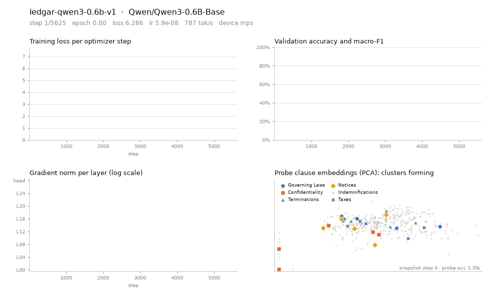
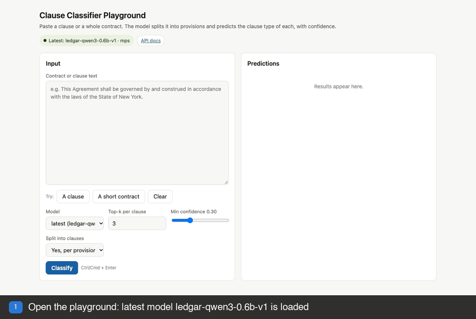
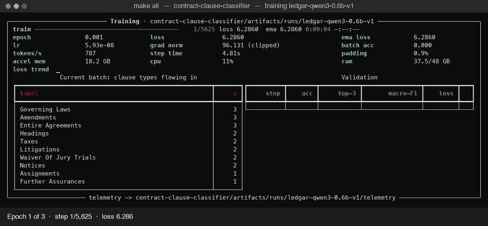

# Contract Clause Classifier

Fine-tune a ~0.6B language model (Qwen3-0.6B) to recognise **clause types in contracts**, train a **classical machine-learning model** on the same data, and serve both through an **OpenAI-compatible FastAPI** with a side-by-side playground.

Give it a contract (text, PDF or DOCX). It splits the contract into provisions, classifies each one into one of **78 clause types** (LEDGAR's 100 labels with legal synonyms merged), and returns calibrated confidences in an OpenAI-style response ([format and real examples](#api-fastapi-openai-compatible)).

Two models, same data, same 10,000-provision LEDGAR test set:

| Model | Type | Test accuracy | Top-3 | Training | Per provision (CPU) |
|---|---|---|---|---|---|
| **`ledgar-qwen3-0.6b-v1`** | fine-tuned transformer (default) | **92.46%** | 97.69% | 10 h on a laptop GPU | 102 ms |
| **`ledgar-tfidf-lr-v2`** | classical: TF-IDF + logistic regression | **90.88%** | 97.33% | 23 min on CPU | 0.8 ms |

Per-provision times are measured on a CPU by `make model-pages`. The classical model has two versions, v1 and v2, with identical results (see [Classical model](#classical-model)). The transformer and the classical model agree on 94.2% of test provisions, and when they agree they are right 94.9% of the time. Details: [Transformer vs classical](#transformer-vs-classical) and the generated model pages ([compare](docs/models/compare.html), [transformer](docs/models/transformer.html), [classical](docs/models/classical.html)).

### How v1 was trained

**Base model**
* Qwen3-0.6B-Base (596M parameters, Apache-2.0), with a classification head; all weights fine-tuned, no LoRA

**Dataset**
* LEDGAR via the LexGLUE benchmark: 80,000 clauses from real contracts filed with the US SEC
* 60k train (2016–17), 10k validation (2018), 10k test (2019), so it is tested on contracts newer than its training data
* 100 labels merged into 78 clause types after a legal review of each synonym group ([details](#label-grouping-100-labels-become-78-clause-types))

**Fine-tuning**
* AdamW, learning rate 2e-5, 6% warm-up, cosine decay
* 3 epochs, effective batch size 32 (4 × 8 gradient accumulation), up to 512 tokens per clause
* Label smoothing 0.1, gradient clipping 1.0, weight decay 0.01
* Best checkpoint by validation accuracy, then temperature scaling for calibrated confidence

**Compute**
* A single laptop with 48 GB of memory, using its built-in GPU through PyTorch
* 9 h 57 min for 5,625 training steps, about 25M tokens, about 30 GB peak memory
* No cloud GPU or dedicated server

**Results on the 10,000-provision test set**
* 92.5% accuracy, 97.7% top-3 accuracy, 89.7% macro-F1
* 2.2% calibration error, down from 7.0% before calibration

Training runs on **any machine** (Apple Silicon MPS, NVIDIA CUDA or CPU, auto-detected). While it trains, a **live dashboard** prints in the terminal and **every step is recorded** to disk so the run can be replayed as charts, a GIF or a video later. Every training run produces a new **model version** (`ledgar-qwen3-0.6b-v1`, `-v2`, …) and no model is ever overwritten. The API serves all versions, defaults to the latest, and includes a browser **playground**.

## See it in action

All three GIFs come from the real `ledgar-qwen3-0.6b-v1` model and its training run.

**1. Model training.** Loss, validation accuracy, gradient flow through the layers, and clause types separating in the model's embeddings, rendered from the run's telemetry.



**2. Playground.** Classifying a clause, then a whole contract, in the browser page served by the API.



**3. Terminal dashboard.** The live training dashboard replayed epoch by epoch: all 5,625 steps in about 20 seconds, pausing at the end of each epoch with the latest validation accuracy.



---

## Contents

1. [See it in action](#see-it-in-action)
2. [How it works](#how-it-works)
3. [Training data](#training-data)
4. [Accuracy: what to expect](#accuracy-what-to-expect)
5. [Requirements](#requirements)
6. [Setup](#setup)
7. [Run the full pipeline](#run-the-full-pipeline)
8. [Model versions](#model-versions)
9. [Classical model](#classical-model)
10. [Transformer vs classical](#transformer-vs-classical)
11. [Training in detail](#training-in-detail)
12. [Training telemetry and visualisation](#training-telemetry-and-visualisation)
13. [Evaluation](#evaluation)
14. [Predict from the command line](#predict-from-the-command-line)
15. [Playground](#playground)
16. [API (FastAPI, OpenAI-compatible)](#api-fastapi-openai-compatible)
17. [Docker](#docker)
18. [Project layout](#project-layout)
19. [Configuration reference](#configuration-reference)
20. [Testing](#testing)
21. [Troubleshooting](#troubleshooting)
22. [Pinned versions](#pinned-versions)
23. [License](#license)
24. [Author](#author)
---

## How it works

```
contract (.txt / .pdf / .docx, or the user message of a chat request)
   │  segment.py   split into provisions (numbered sections, headings, paragraphs)
   ▼
[provision 1 … provision n]
   │  Qwen3-0.6B-Base, fully fine-tuned, + 78-way classification head
   │  (last-token pooling, temperature-scaled softmax)
   ▼
per-provision top-k [{name, confidence}]
   │  aggregate: max confidence per clause type across provisions
   ▼
{"document": [...], "clauses": [...], "num_clauses": n}
```

| Choice | What | Why |
|---|---|---|
| Dataset | [LEDGAR](https://huggingface.co/datasets/coastalcph/lex_glue) (LexGLUE) | 80,000 real contract provisions from SEC filings, chronological train/validation/test split (60k / 10k / 10k). Not CUAD, by design. |
| Labels | 100 LEDGAR labels merged into 78 clause types | 19 groups of legal synonyms ("Applicable Laws" = "Governing Laws", …), each verified on the rows like a contracts lawyer would and confirmed by confusion statistics. See [Training data](#training-data). |
| Model | [Qwen/Qwen3-0.6B-Base](https://huggingface.co/Qwen/Qwen3-0.6B-Base) | 0.6B parameters, Apache-2.0, strong for its size. Swap to `Qwen/Qwen2.5-0.5B` or `HuggingFaceTB/SmolLM2-360M` with one config line. |
| Method | Full fine-tuning (all 596M weights), label smoothing 0.1, 3 epochs, early stopping on accuracy | Measured only about 17% slower than LoRA on the training laptop and usually 1 to 2 points more accurate. LoRA (r=64) is one flag away. |
| Framework | PyTorch + Hugging Face `transformers` + `peft` | Same code on MPS, CUDA and CPU. |
| Confidence | Softmax with temperature scaling fitted on validation | Confidences are calibrated, so 0.9 means right about 90% of the time. |

LEDGAR labels each provision with a single clause type. Multiple clause types per contract come from classifying each provision separately; multiple labels per provision come from the top-k list above the threshold.

The full design rationale is in [plans/PLAN.md](plans/PLAN.md).

---

## Training data

The model is trained on **LEDGAR** (Labeled EDGAR), as packaged in the [LexGLUE benchmark](https://huggingface.co/datasets/coastalcph/lex_glue) (`coastalcph/lex_glue`, config `ledgar`).

| | |
|---|---|
| Source | Provisions (paragraphs) of commercial contracts filed with the US Securities and Exchange Commission and published on EDGAR, which is public information. Collected by Tuggener et al., [LREC 2020](https://aclanthology.org/2020.lrec-1.155). |
| Size | 80,000 provisions from 12,000+ contracts: **60,000 train** (filed 2016 to 2017), **10,000 validation** (2018), **10,000 test** (2019). The chronological split means the test set is newer than the training set. |
| Labels | **100 labels**, one per provision, chosen by LexGLUE as the 100 most frequent of the original 12,000+ section headings. This project merges legal synonyms into **78 clause types** (below). |
| Text | English. Average provision is 114 words (median 86); with the Qwen3 tokenizer, mean 138 tokens and 1.9% longer than the 512-token limit. |
| Format | Two columns, `text` and `label` (an integer id into the label list). Three parquet files (28 MB) **committed in `data/raw/ledgar/`**, so every clone trains and evaluates on identical rows; `make data` only tokenises them (delete them to re-download). [`data/raw/ledgar/README.md`](data/raw/ledgar/README.md) credits the sources with the exact download URL, date and checksum of every file. |
| License | LexGLUE is published under **CC BY 4.0**; the underlying filings are public SEC records. See [License](#license). |

The 100 original labels:

> Adjustments, Agreements, Amendments, Anti-Corruption Laws, Applicable Laws, Approvals, Arbitration, Assignments, Assigns, Authority, Authorizations, Base Salary, Benefits, Binding Effects, Books, Brokers, Capitalization, Change In Control, Closings, Compliance With Laws, Confidentiality, Consent To Jurisdiction, Consents, Construction, Cooperation, Costs, Counterparts, Death, Defined Terms, Definitions, Disability, Disclosures, Duties, Effective Dates, Effectiveness, Employment, Enforceability, Enforcements, Entire Agreements, Erisa, Existence, Expenses, Fees, Financial Statements, Forfeitures, Further Assurances, General, Governing Laws, Headings, Indemnifications, Indemnity, Insurances, Integration, Intellectual Property, Interests, Interpretations, Jurisdictions, Liens, Litigations, Miscellaneous, Modifications, No Conflicts, No Defaults, No Waivers, Non-Disparagement, Notices, Organizations, Participations, Payments, Positions, Powers, Publicity, Qualifications, Records, Releases, Remedies, Representations, Sales, Sanctions, Severability, Solvency, Specific Performance, Submission To Jurisdiction, Subsidiaries, Successors, Survival, Tax Withholdings, Taxes, Terminations, Terms, Titles, Transactions With Affiliates, Use Of Proceeds, Vacations, Venues, Vesting, Waiver Of Jury Trials, Waivers, Warranties, Withholdings

The classes are imbalanced. In the training split the most frequent types are Governing Laws (3,167), Notices (2,493), Counterparts (2,427), Entire Agreements (2,340) and Severability (1,808); the rarest are Books (23), Assigns (31), Qualifications (47), Anti-Corruption Laws (106) and Sanctions (118). Macro-F1 is therefore reported alongside accuracy, and `train.class_weighted_loss` can up-weight rare types.

Example rows:

| text | label |
|---|---|
| This Lease shall in all respects be governed by the laws of the State of New York. | Governing Laws |
| The Committee may terminate the Plan at any time and grant no further Restricted Fund Shares. | Terminations |
| Except as otherwise set forth in this Debenture, the Company ... expressly waives presentment, protest, demand, notice of dishonor ... | Waivers |

Browse the data yourself with `make data` and then `GET /v1/dataset?split=train&offset=0&limit=10` on the API, or read `data/raw/ledgar/*.parquet` directly.

**What the model does not learn from this data.** LEDGAR labels one clause type per provision and contains no annotation of risk, parties, dates or obligations. Multi-label output for a whole contract comes from splitting it into provisions. Provisions written in styles far from SEC-filed commercial contracts (consumer terms, non-English text) will be classified less reliably.

**Clause types missing from LEDGAR.** The 100 labels are the most frequent SEC section headings, so several clauses common in commercial contracts are not among them: **Limitation of Liability, Force Majeure, Non-Compete, Non-Solicitation, Audit Rights, Exclusivity, Most Favored Nation, Warranty Disclaimer, Liquidated Damages** (and "Services", "Delivery", "Price"). The model cannot output these; it returns the closest type it knows, usually with lower confidence. For example, on `demo/sample_contract.txt` a Limitation of Liability section comes back as Indemnifications at 72%, a services description as Payments at 20%, and the preamble as Releases at 51%. Treat predictions below about 80% as uncertain. Covering these types needs labelled examples of them added to the training data.


### Label grouping: 100 labels become 78 clause types

LEDGAR's label is the heading each drafter happened to choose, so one clause type often appears under several names. In the first training run (LoRA, raw labels, stopped at step 1,288), **38% of all validation errors were between such synonyms**: Applicable Laws vs Governing Laws (18 errors in 3,000), Tax Withholdings vs Withholdings (17), Representations vs Warranties (17), Definitions vs Defined Terms (16), Integration vs Entire Agreements (13), and so on. The text gives no way to tell them apart, so these are label noise, not model mistakes.

Each merge in [configs/ledgar_label_groups.yaml](configs/ledgar_label_groups.yaml) had to pass two tests, documented in the file:

1. **Legal test.** The headings denote the same legal concept, judged on the actual provisions the way a contracts lawyer would read them. For example, 75% of "Warranties" rows are "represents and warrants" sections (5% are product warranties), and 75% of "Authorizations" rows are the due-authorization representation (8% concern permits), so both merges hold. Headings that share words but carry different legal meaning stay separate: Term vs Termination, Fees vs Expenses, Taxes vs Withholdings, Venue vs Jurisdiction, Remedies vs Specific Performance, Assignment vs Successors and Assigns.
2. **Statistical test.** An independent TF-IDF classifier on the full 10,000-row validation split confuses the members with each other (at least about 8% of their combined rows, or 40% of one member's errors).

19 groups merge 41 labels:

| Clause type | Original LEDGAR labels |
|---|---|
| Governing Laws | Governing Laws, Applicable Laws |
| Withholdings | Withholdings, Tax Withholdings |
| Representations and Warranties | Representations, Warranties |
| Definitions | Definitions, Defined Terms |
| Entire Agreements | Entire Agreements, Integration |
| Construction | Construction, Interpretations |
| Authority | Authority, Authorizations |
| Successors and Assigns | Successors, Assigns, Binding Effects |
| Indemnifications | Indemnifications, Indemnity |
| Organization and Existence | Organizations, Existence, Qualifications |
| Amendments | Amendments, Modifications |
| Expenses | Expenses, Costs |
| Jurisdiction | Jurisdictions, Submission To Jurisdiction, Consent To Jurisdiction |
| Waivers | Waivers, No Waivers |
| Effectiveness | Effectiveness, Effective Dates |
| Duties and Positions | Duties, Positions |
| Books and Records | Books, Records |
| Consents and Approvals | Consents, Approvals |
| Sanctions and Anti-Corruption Laws | Sanctions, Anti-Corruption Laws |

The other 59 labels keep their names. Measured on the first run's validation confusion matrix at the same checkpoint, this moves accuracy from **83.0% to 88.9%** (35% fewer errors); the TF-IDF baseline moves from 87.8% to 91.2% on the full validation split. The rarest class grows from 23 to 125 training examples. Set `data.label_groups: null` in the config to train on the original 100 labels. Every model saves the label space it was trained with (`label_space.json`), so older versions remain evaluable after the groups change. `/v1/dataset` shows both the clause type (`label`) and the original heading (`original_label`) for every row.

---

## Accuracy: what to expect

The target for this project is 96 to 99% accuracy. Here is what the evidence supports, so the number you see after training is not a surprise.

| Setting | Top-1 accuracy | Source |
|---|---|---|
| Published state of the art on LEDGAR, 100 labels (BERT, RoBERTa, DeBERTa-class models) | about 88% | [LexGLUE](https://arxiv.org/abs/2110.00976) |
| First run here: LoRA r=16, 100 labels, half an epoch | 83.0% | measured |
| Same checkpoint scored on the 78 merged clause types | 88.9% | measured |
| Independent TF-IDF baseline, full validation split: 100 labels / 78 clause types | 87.8% / 91.2% | measured |
| **`ledgar-qwen3-0.6b-v1`: default config (78 clause types, full fine-tune, 3 epochs), full 10,000-row test split** | **92.46% top-1, 97.69% top-3, macro-F1 89.7%** | measured by `make evaluate` |
| Calibration error after temperature scaling (test) | 2.2% (7.0% before) | measured; temperature 0.80 fitted on the 10,000-row validation split |

The v1 result is 4.5 points above the published 100-label state of the art and in the expected range. 96% top-1 is above what this data supports without further merging, and 99% top-1 is not reachable on LEDGAR. The remaining errors are mostly clause types that are legally distinct but written alike. v1's most frequent test confusions: Taxes vs Withholdings (21), Representations and Warranties vs Survival (13), Assignments vs Successors and Assigns (13), General vs Payments (12), Amendments vs Entire Agreements (10). Weakest classes by F1: Venues (0.43, 20 test rows), Powers (0.58), Miscellaneous (0.58), Enforceability (0.62), Enforcements (0.63). The levers that would go further:

1. **Merge more clause types** that you consider the same for your use case (edit the groups file; no re-tokenising needed). Groups rejected on legal grounds are listed in the file; merging them would add 2 to 3 points at the cost of legal precision.
2. **Use the top-3 output**: the API already returns the top-k labels with calibrated confidences, and v1's top-3 accuracy is 97.7%.
3. **Train on your own labelled contracts** with your own taxonomy. Consistent labels are the single biggest factor; a cleanly labelled in-house set routinely reaches 97 to 99% with this model size.
4. **A larger backbone** (for example Qwen3-1.7B) typically adds 1 to 2 points at three times the training time.

---

## Requirements

| | Minimum | Tested |
|---|---|---|
| OS | macOS on Apple Silicon, or Linux | a laptop with 48 GB of memory and a built-in GPU |
| Memory | 32 GB unified memory / RAM for training (24 GB with `full_finetune: false`) | 25 to 30 GB of accelerator memory with the default config (30 GB peak in the v1 run) |
| Disk | 15 GB free per model version | base model 1.2 GB, data 0.1 GB, each full-fine-tune version about 10 GB (2 GB with LoRA) |
| Python | 3.12 (installed by uv automatically) | 3.12.13 |
| Tools | `make` and Docker ([Colima](https://github.com/abiosoft/colima) or Docker Desktop), which run every step by default; [uv](https://docs.astral.sh/uv/) to run steps on the machine itself, which a Mac needs for transformer training | Docker 29 on Colima, uv 0.11 |

Training time for the default config (full fine-tune, up to 3 epochs, 5,625 optimizer steps; early stopping often ends sooner):

| Hardware | Time |
|---|---|
| Laptop with 48 GB and a built-in GPU (measured, v1) | 9 h 57 min for 3 epochs (5.9 s per step on average, about 3.2 hours per epoch, including 12 evaluations totalling 26 minutes) |
| Modern NVIDIA GPU (CUDA, bf16) | about 1 to 1.5 hours |

---

## Setup

Every `make` command runs in Docker by default, so Docker is the only thing to install for most of the work. Steps that need the Apple GPU run on the machine itself with uv.

```bash
# 1. From the project folder: build the two Docker images (tools for every step, api for serving)
cd contract-clause-classifier
make setup            # same as: make docker-build

# 2. Check everything works (no model or download needed)
make test
```

To run steps on the machine itself, for example transformer training on a Mac, install uv as well:

```bash
curl -LsSf https://astral.sh/uv/install.sh | sh
```

```bash
make setup RUNNER=local      # uv sync: Python 3.12 and all pinned dependencies into .venv
```

### Where commands run: Docker or local

`RUNNER` picks where each `make` command runs. It is `docker` unless you pass `RUNNER=local` or set it in your shell.

| | `RUNNER=docker` (default) | `RUNNER=local` |
|---|---|---|
| How | `docker compose run --rm tools ...`: the tools image has Python 3.12 and every package from `uv.lock`; this folder is mounted into it, so outputs land here as usual and are owned by you | `uv run ...` with the `.venv` from `uv sync` |
| Device | CPU (Docker on macOS cannot use the Apple GPU); an NVIDIA GPU on Linux with `GPU=1` | CUDA, Apple GPU or CPU, whichever is available |
| `make serve` | the API container (`docker compose up api`), Ctrl+C stops it | the API on this machine |

What that means per command:

| Commands | In Docker |
|---|---|
| `make data`, `classical`, `all FAMILY=classical`, `evaluate`, `predict`, `compare`, `model-pages`, `gif`, `terminal-gif`, `models`, `next`, `bump`, `test`, `rules`, `changelog-html` | run as usual, on CPU |
| `make all`, `train`, `resume`, `restart`, `sanity` (transformer training) | stop with a hint unless `GPU=1` (NVIDIA on Linux): CPU training would take days and need more memory than the Docker VM has. On a Mac use `make all RUNNER=local`. `ALLOW_CPU_TRAIN=1` forces CPU training in Docker. |
| `make playground-gif` | always runs on this machine: it drives your installed Chrome |
| `make shell` | opens a shell in the tools container |

**Colima users.** Colima shares only the folders listed under `mounts:` in `~/.colima/default/colima.yaml`. Add the folder that contains this project once, with `writable: true`, then run `colima restart`. Otherwise the tools container stops with a message saying the project folder is not visible.

Other notes:

* Evaluating the transformer in Docker runs on CPU, so it is slower than on the Apple GPU. Use `make evaluate RUNNER=local` for speed; the numbers are the same.
* Hugging Face downloads (the Qwen3 tokenizer and base model) are kept in the Docker volume `hf-cache`, so they happen once.
* `make terminal-gif` uses the DejaVu Sans Mono font in Docker, because Menlo exists only on macOS.
* The script commands shown in this README (`uv run python scripts/...`) run on the machine itself. The Docker equivalent is `docker compose run --rm tools python scripts/...`, or `make shell` and then `python scripts/...`.
* After changing dependencies (`pyproject.toml`, `uv.lock`) or the Dockerfile, run `make docker-build`. Code, config and data changes need no rebuild, because the folder is mounted.

### Dependencies

`uv sync` reads `.python-version` (3.12) and `uv.lock`, so everyone gets the identical, tested set of packages. Dependency groups:

| Group | Contents | Installed by |
|---|---|---|
| runtime | torch, transformers, FastAPI, scikit-learn, pyarrow, PyMuPDF, python-docx, rich, psutil … | always, and in both Docker images |
| `train` | peft, accelerate | `uv sync` (default), tools image |
| `viz` | matplotlib, pillow | `uv sync` (default), tools image |
| `dev` | pytest, httpx, openai | `uv sync` (default), tools image |

Optional: copy `.env.example` to `.env` to change API settings.

---

## Run the full pipeline

One command runs everything: download data, train with the live dashboard, evaluate and calibrate, and render the training GIF.

```bash
make all RUNNER=local     # on a Mac: transformer training needs the Apple GPU, so it runs outside Docker
make all GPU=1            # on Linux with an NVIDIA GPU: runs in Docker
```

The classical model trains on a CPU and runs fully in Docker with `make classical` (see [Classical model](#classical-model)). Every other step below runs in Docker by default; add `RUNNER=local` to run it on the machine itself (see [Where commands run](#where-commands-run-docker-or-local)).

`make all` trains the next model version (see [Model versions](#model-versions)), evaluates it, renders its GIF into `demo/`, raises `model_version` in the config, and lists all models. Or step by step:

```bash
make data       # 1. tokenize the LEDGAR data shipped in data/raw/ledgar (downloads only if missing)
make train RUNNER=local   # 2. train the next version, e.g. ledgar-qwen3-0.6b-v1; live dashboard + telemetry
make evaluate   # 3. calibrate confidences on validation, report test metrics (latest model)
make gif        # 4. render the latest model's telemetry charts to a GIF (also copied to demo/)
make terminal-gif  # 4b. replay the terminal dashboard epoch by epoch as a GIF (demo/<version>_terminal.gif)
make bump       # 5. raise model_version so the next run becomes -v2
make predict    # classify demo/sample_contract.txt with the latest model
make serve      # API + playground on http://localhost:8000/playground
```

Each `make` target is a thin wrapper; the underlying commands are in the [Makefile](Makefile) (`make help` lists them).

**Where the trained model goes.** Each version gets its own folder, `artifacts/runs/ledgar-qwen3-0.6b-v<N>/`, with the servable model in `merged/`. Nothing is overwritten. `artifacts/best` always links to the latest version for convenience; the API, the CLI and Docker read the versions directly.

---

## Model versions

`model_version` in [configs/ledgar_qwen3_0.6b.yaml](configs/ledgar_qwen3_0.6b.yaml) is the version the **next** training run will produce. It starts at 1.

```text
model_version: 1  ->  make all  ->  trains artifacts/runs/ledgar-qwen3-0.6b-v1  ->  evaluate, GIF  ->  model_version: 2
model_version: 2  ->  make all  ->  trains artifacts/runs/ledgar-qwen3-0.6b-v2  ->  evaluate, GIF  ->  model_version: 3
```

Rules:

* **Never overwrite.** If `-v<N>` already exists and is complete, training moves on to the next free version and says so.
* **Bump only on success.** `make bump` (the last step of `make all`) raises the version only if `-v<N>` finished. A failed or interrupted run is retried under the same version.
* **Unfinished runs are never silently replaced.** If `-v<N>` exists but did not finish, training stops and tells you to run `make resume` (continue from the last checkpoint) or `make restart` (delete it and start over). Both then evaluate, render the GIF and bump.
* **Latest** means the newest completed versioned model. Explicitly named runs such as `make sanity` are never "latest" while a versioned model exists.
* The base name comes from `train.run_name` (`ledgar-qwen3-0.6b`). Change it to start a separate series, for example `ledgar-qwen3-0.6b-lora`.

```bash
make models                     # list every version with validation and test metrics; latest is marked
make next                       # the name the next run will use
make evaluate MODEL=ledgar-qwen3-0.6b-v1    # any command that takes MODEL= accepts a version id or "latest"
make predict FILE=contract.pdf MODEL=ledgar-qwen3-0.6b-v1
make adopt RUN=ledgar-qwen3-0.6b-lora       # turn a finished unversioned run into the next version
```

Sample `make models` output (after the first run):

```text
                                       Models in contract-clause-classifier/artifacts/runs
┏━━━━━━━━━━━━━━━━━━━━━━┳━━━━━━━━━┳━━━━━━━━━━━━━━━━━━┳━━━━━━━━━┳━━━━━━━━━━━━━━┳━━━━━━━━━━┳━━━━━━━━━━━━┳━━━━━━━━━━━━━━━┳━━━━━━━━┓
┃ model                ┃ version ┃ created          ┃ val acc ┃ val macro-F1 ┃ test acc ┃ test top-3 ┃ test macro-F1 ┃        ┃
┡━━━━━━━━━━━━━━━━━━━━━━╇━━━━━━━━━╇━━━━━━━━━━━━━━━━━━╇━━━━━━━━━╇━━━━━━━━━━━━━━╇━━━━━━━━━━╇━━━━━━━━━━━━╇━━━━━━━━━━━━━━━╇━━━━━━━━┩
│ ledgar-qwen3-0.6b-v1 │ 1       │ 2026-10-11 15:12 │ 0.9223  │ 0.8988       │ 0.9246   │ 0.9769     │ 0.8967        │ latest │
└──────────────────────┴─────────┴──────────────────┴─────────┴──────────────┴──────────┴────────────┴───────────────┴────────┘
Next training run: model_version=2 in contract-clause-classifier/configs/ledgar_qwen3_0.6b.yaml
```

Each version's `merged/model_info.json` records its id, version, creation time, base model, method, label count, best validation scores and, after `make evaluate`, its test scores.

---

## Classical model

A traditional machine-learning classifier trained on exactly the same data, splits and 78 clause types as the transformer, kept in its own folders: `src/classification/classical/`, `configs/classical/`, `scripts/classical/`, `artifacts/classical/runs/`. It runs on the CPU, trains in minutes, and every prediction can be traced to weighted phrases.

```bash
make classical                 # data -> train -> evaluate -> model pages -> bump the classical version
make all FAMILY=classical      # the same flow through `make all`
make all-classical             # alias
```

`make all --classical` is not possible because `make` reads `--classical` as one of its own options; use one of the three commands above. The plain `make all` still runs the transformer flow, unchanged.

| Step | Command | What it does |
|---|---|---|
| Train | `make classical-train` | TF-IDF features (word 1-2 grams + character 3-5 grams, 253,103 features) fitted once on the training split; logistic regression for C in {3, 10, 30}, the best by validation accuracy is served; linear SVM and Complement Naive Bayes trained on the same features for comparison; learning curve on 10/25/50/100% of the data |
| Evaluate | `make classical-evaluate` | temperature calibration on validation, full test report (same format as the transformer), CPU latency, test predictions for the comparison |
| Pages | `make model-pages` | regenerates `docs/models/{compare,transformer,classical}.html` |
| Bump | `make classical-bump` | raises `model_version` in `configs/classical/ledgar_tfidf_lr.yaml` (after v1 and v2 the next run is `ledgar-tfidf-lr-v3`) |

Versions follow the same rules as the transformer: every run is a new `ledgar-tfidf-lr-v<N>`, nothing is overwritten, and `make models` lists both families. Requests for `latest-classical`, the playground's compare mode and the model pages use the newest classical version.

| Version | Trained | Test accuracy | Top-3 | Macro-F1 | Train time | Status |
|---|---|---|---|---|---|---|
| `ledgar-tfidf-lr-v1` | 2026-10-11 | 90.88% | 97.33% | 88.24% | 1,441 s | kept, selectable by id |
| `ledgar-tfidf-lr-v2` | 2026-10-11 | 90.88% | 97.33% | 88.24% | 1,391 s | **latest classical** |

v2 was trained with the same settings as v1 and reproduces it exactly: every validation, learning-curve and test number matches, and only the timings differ. Training is deterministic (fixed `seed`, deterministic solvers), so a new classical version changes results only when the config or the data changes.

Measured for `ledgar-tfidf-lr-v2` (identical for v1):

| Candidate (validation split, 10,000 rows) | Accuracy | Top-3 | Macro-F1 | Log loss | Fit |
|---|---|---|---|---|---|
| **Logistic regression, C=30 (served)** | **91.38%** | 97.56% | 88.40% | 0.345 | 298 s |
| Logistic regression, C=10 | 91.36% | 97.60% | 88.35% | 0.344 | 314 s |
| Logistic regression, C=3 | 91.04% | 97.57% | 87.81% | 0.375 | 251 s |
| Linear SVM, C=1 (calibrated) | 91.78% | 97.15% | 88.78% | 0.378 | 102 s |
| Linear SVM, C=0.5 | 91.58% | 97.17% | 88.61% | – | 45 s |
| Complement Naive Bayes, alpha=0.1 | 84.19% | 94.25% | 77.64% | 1.161 | 1 s |

The linear SVM is 0.4 points more accurate on validation, but logistic regression is served because it gives real probabilities for the confidence scores and readable per-class phrase weights. The learning curve still rises at 60,000 provisions (86.7% with 6,000, 88.7% with 15,000, 89.8% with 30,000, 91.4% with 60,000), so more data would help this model more than tuning.

On the test split: **90.88% accuracy, 97.33% top-3, 88.24% macro-F1, 1.9% calibration error**, under 1 ms per provision on one CPU core, 145 MB on disk. The [classical page](docs/models/classical.html) has every candidate, the learning and loss curves, per-class F1, confusions, and the strongest phrases for each clause type.

---

## Transformer vs classical

Every number below is from the same 10,000-provision test split ([full comparison page](docs/models/compare.html)).

| | Transformer `ledgar-qwen3-0.6b-v1` | Classical `ledgar-tfidf-lr-v2` |
|---|---|---|
| Accuracy | **92.46%** | 90.88% |
| Top-3 accuracy | **97.69%** | 97.33% |
| Macro-F1 | **89.67%** | 88.24% |
| Calibration error | 2.2% | **1.9%** |
| Clause types where it has higher F1 (by more than 0.5 points) | **53** | 11 |
| Training | 10 h, laptop GPU | **23 min, CPU** |
| Per provision on a CPU | 102 ms | **0.8 ms** |
| Size | 1.2 GB | **145 MB** |
| Explainability | none built in | **weighted phrases per clause type** |

**They agree on 94.2% of provisions, and are right 94.9% of the time when they do.** On the 580 provisions where they disagree, the transformer is right 52.8%, the classical model 25.5%, and both are wrong 21.7%. Agreement is therefore a useful confidence signal: when the two disagree, the provision deserves a human look. Both make the same kinds of mistakes (Taxes vs Withholdings, Assignments vs Successors and Assigns), which points to genuinely ambiguous clause types rather than model weaknesses.

Use the transformer for the best accuracy and for unusual wording, the classical model where speed, cost or explanations matter, and both together (the playground's compare mode, `POST /v1/compare`) to flag uncertain provisions.

**Model pages.** `make model-pages` generates three standalone pages from the saved artifacts, also served by the API at `/models/compare`, `/models/transformer` and `/models/classical`:

* [`docs/models/compare.html`](docs/models/compare.html): side-by-side metrics, agreement analysis, per-class F1 differences, confusions, recommendation.
* [`docs/models/transformer.html`](docs/models/transformer.html): architecture, training settings, loss and learning-rate curves, validation curves, test metrics, per-class F1, confusions, versions.
* [`docs/models/classical.html`](docs/models/classical.html): features and classifier, candidates with training and validation log loss, learning curve, test metrics, per-class F1, confusions, top phrases per clause type.

GitHub shows `.html` files as source; open them locally, through the API, or publish `docs/` with GitHub Pages to view them rendered.

---

## Training in detail

```bash
make train                     # trains the next version (ledgar-qwen3-0.6b-v<model_version>)
make resume RUNNER=local       # continue an interrupted version, then evaluate, GIF and bump
make restart RUNNER=local      # discard an unfinished version and train it again from scratch
make sanity RUNNER=local       # 5-minute smoke test on 256 examples (unversioned run "sanity")
```

Direct invocation with overrides (any config value can also be changed in the YAML):

```bash
uv run python scripts/02_train.py --epochs 2 --lr 3e-5             # next version with overrides
uv run python scripts/02_train.py --model-name Qwen/Qwen2.5-0.5B     # different backbone
uv run python scripts/02_train.py --run-name my-experiment         # explicit name, no version suffix
uv run python scripts/02_train.py --device cpu --limit 2000          # force CPU, subset
```

### What you see in the terminal

The [terminal dashboard GIF](#see-it-in-action) at the top replays the live dashboard of the `ledgar-qwen3-0.6b-v1` run from its telemetry: all 5,625 steps compressed into about 20 seconds, pausing at the end of each of the 3 epochs with the latest validation accuracy in the caption. `make all` renders one for every new version (`demo/<version>_terminal.gif`); re-render any run with `make terminal-gif MODEL=<version>`. It needs only the telemetry folder, no GPU or browser.


A live panel refreshes twice a second: progress and ETA, loss and smoothed loss with a trend sparkline, learning rate, gradient norm (and whether it was clipped), tokens per second, padding ratio, accelerator memory, CPU and RAM, the top 10 clause types in the current batch, and the last 10 validation results (accuracy, top-3 accuracy, macro-F1). Paths are shown relative to the project, for example `contract-clause-classifier/artifacts/runs/ledgar-qwen3-0.6b-v1`. The panel sizes itself to the terminal window so it redraws in place; in a short window it shows fewer table rows. If output is redirected to a file, it prints one plain log line every 10 steps instead.

### What happens during a run

1. The Qwen3 backbone is loaded with a fresh 78-way classification head (all weights train; LoRA adapters instead when `full_finetune: false`).
2. Batches are grouped by length to cut padding (about 2% padding instead of about 50%).
3. Every 500 optimizer steps it evaluates on a fixed 3,000-example validation subset, saves `checkpoint-last/` (with optimizer state for resume), and keeps `checkpoint-best/` by accuracy (`train.best_metric`). Training stops early after 4 evaluations without improvement.
4. At the end, `checkpoint-best/` becomes the standalone model in `merged/` with a `model_info.json`, and `artifacts/best` is pointed at the latest version.

### Run directory

```
artifacts/runs/ledgar-qwen3-0.6b-v<N>/
├── config.yaml          resolved config used for the run
├── metrics.jsonl        compact log (every 10 steps + each eval)
├── checkpoint-best/     best weights (or LoRA adapter) + tokenizer
├── checkpoint-last/     latest adapter + optimizer/scheduler state (for --resume)
├── merged/              standalone serving model (bf16 safetensors, labels.json, label_space.json, model_info.json, calibration.json, eval.json)
├── telemetry/           everything needed to replay the run (next section)
└── visuals/             training.gif / training.png (after `make gif`)
```

### Memory notes for Apple Silicon

The default micro-batch is 4 with 8 accumulation steps (effective batch 32). Full fine-tuning then uses 25 to 30 GB of accelerator memory (30 GB peak in the v1 run); LoRA about 19 GB. A micro-batch of 8 pushes the MPS allocator past 35 GB and starts swapping on a 48 GB machine. The trainer also releases cached accelerator memory every 25 steps. Closing heavy apps (browsers, Docker VMs) during training helps.

---

## Training telemetry and visualisation

Every run records its full history to `artifacts/runs/<run-name>/telemetry/`. Files are append-only and line-buffered, so they survive crashes and `--resume`, and can be read while training is still going.

| File | What it captures |
|---|---|
| `meta.json` | config, hardware and software versions, dataset statistics (label counts, length histograms), probe-set ids, label names |
| `steps.jsonl` | one line per optimizer step: loss, learning rate, gradient norm, clipping, step time, tokens/s, padding, memory, and the batch itself: example ids, labels, lengths, per-example loss and correctness |
| `layers.jsonl` | every 10 steps: gradient norm of each of the 28 transformer layers and the head |
| `evals.jsonl` | each evaluation: accuracy, top-3 accuracy, macro-F1, loss, per-class F1 for every clause type, trainable weight norm per layer |
| `evals/step_*.npz` | each evaluation: 100x100 confusion matrix and calibration bins |
| `snapshots/step_*.npz` | at step 0 and each evaluation, for a fixed probe set of about 500 validation examples: predicted probabilities, final-layer embeddings, per-layer activation norms, and full per-layer vectors for about 100 of them |
| `events.jsonl` | start, snapshot, eval, checkpoint, early stop, done |
| `system.jsonl` | every 5 seconds: CPU %, RAM, process memory, accelerator memory, training phase |

Together these show how the loss fell, which clause types the model learned first, how each layer's gradients evolved, how individual examples flowed through training, and how each clause type's representation moved through the network's layers and separated into clusters. The exact schema is in [docs/TELEMETRY.md](docs/TELEMETRY.md).

Render a GIF at any time, including mid-training:

```bash
make gif                                          # latest model, copies to demo/
make gif MODEL=ledgar-qwen3-0.6b-v1               # a specific version
uv run python scripts/06_render_gif.py --run artifacts/runs/sanity --frames 80 --fps 10
```

---

## Evaluation

```bash
make evaluate                                   # latest model
make evaluate MODEL=ledgar-qwen3-0.6b-v1        # a specific version
uv run python scripts/03_evaluate.py --model-dir artifacts/runs/<run>/merged --limit 1000   # any folder, quick
```

It fits a temperature on the validation split, writes `calibration.json` next to the model (the API applies it automatically, even if it is already running), and writes `eval.json` with test accuracy, top-3 accuracy, micro, macro and weighted F1, log loss, calibration error before and after scaling, per-class precision and recall, and the most frequent confusions. The headline numbers are also stored in the model's `model_info.json`, so `make models` and `/v1/models` show them.

See [Accuracy: what to expect](#accuracy-what-to-expect) for reference numbers.

---

## Predict from the command line

```bash
uv run python scripts/04_predict.py demo/sample_contract.txt
uv run python scripts/04_predict.py path/to/contract.pdf --top-k 5 --threshold 0.2 --out result.json
uv run python scripts/04_predict.py --text "This Agreement shall be governed by the laws of New York."
uv run python scripts/04_predict.py contract.pdf --model ledgar-qwen3-0.6b-v1     # a specific version
```

The latest model is used unless `--model` names a version. Input is split into provisions by default; `--no-segment` classifies it as one clause. Inputs: `.txt`, `.md`, `.pdf` with a text layer, `.docx`. Scanned PDFs need OCR first.

Sample output for the `--text` call:

```json
{
  "document": [
    {"name": "Governing Laws", "confidence": 0.9748}
  ],
  "clauses": [
    {
      "index": 0,
      "text": "This Agreement shall be governed by the laws of New York.",
      "predictions": [
        {"name": "Governing Laws", "confidence": 0.9748}
      ]
    }
  ],
  "num_clauses": 1
}
```

`document` lists every clause type found anywhere in the input with its best confidence, highest first. `clauses` gives the top-k predictions per provision (the top-1 is always kept, the rest only above the threshold). A provision the model is unsure about can therefore appear in `clauses` with a low-confidence top-1 while adding nothing to `document`.

> All sample outputs in this README are real responses from `ledgar-qwen3-0.6b-v1`, the first fully trained model (92.5% test accuracy).

---

## Playground

```bash
make serve          # then open http://localhost:8000/playground
```

A single page served by the API (see the [playground GIF](#see-it-in-action) at the top; no extra dependencies). Paste a clause or a whole contract, or load one of the samples, adjust top-k and the confidence threshold, and press **Classify** (or Ctrl/Cmd + Enter).

**Compare mode is the default** when both a transformer and a classical model are trained: the text is split once and both models classify the same provisions. It shows:

* **Clause types found**: for every clause type, two confidence bars, blue for the transformer and orange for the classical model. The legend also shows each model's measured test accuracy, so you see both how sure each model is on this text and how accurate it is overall.
* **Per clause**: each provision with both models' top predictions and confidences, marked **agree** or **differ**.
* Both models' latency, the agreement count, and the raw `POST /v1/compare` response.

The model menu also offers a single model: the latest transformer, the latest classical model, or any specific version. In single-model mode it shows that model's clause types, per-clause predictions, latency and token count. The header links to the three model pages.

The status pill shows the latest model and device. Before any model is trained it explains how to train one. If the server has an `API_KEY`, the page asks for it. `http://localhost:8000/` redirects to the playground.

The playground GIF is a real session with `ledgar-qwen3-0.6b-v1`. Re-record it after training a new version with:

```bash
make playground-gif        # drives headless Chrome through the playground -> demo/playground_usage.gif
```

It starts the API if none is running, needs Google Chrome or Chromium (set `CHROME=/path/to/chrome` if it is elsewhere), and takes about 10 seconds. Note what the recording shows: the IP-infringement indemnity in the sample contract is labelled Intellectual Property at 65% by the transformer (amber, uncertain, because its wording is about IP rights) and Indemnifications at 99.8% by the classical model, which is right. That clause is marked **differ**, exactly the kind of provision compare mode is meant to surface.

---

## API (FastAPI, OpenAI-compatible)

```bash
make serve                       # http://localhost:8000; playground at /playground, Swagger UI at /docs, schema at /openapi.json
```

| Method | Path | Purpose |
|---|---|---|
| GET | `/health` | 200 when the latest model is loaded (with all available versions), 503 otherwise |
| GET | `/v1/models` | every trained version, newest first; `is_latest` marks the default |
| GET | `/v1/models/{id}` | one version (`latest` and base names resolve too) |
| POST | `/v1/chat/completions` | classify the last user message with the latest transformer, or the model named in `model` (`latest-classical` or any version id) |
| POST | `/v1/compare` | both model families on the same provisions, side by side, with agreement |
| GET | `/v1/dataset` | LEDGAR rows, 10 per page by default: `?split=train&offset=0&limit=10` (limit max 100) |
| GET | `/v1/labels` | the 78 clause types |
| GET | `/playground` | browser playground, compare mode by default (`/` redirects here) |
| GET | `/models/compare`, `/models/transformer`, `/models/classical` | the generated model pages |

### Endpoints with sample requests and responses

#### `GET /health`

```bash
curl -s localhost:8000/health
```

`200` when the latest model is loaded:

```json
{
  "status": "ok",
  "model_loaded": true,
  "model": "ledgar-qwen3-0.6b-v1",
  "latest_model": "ledgar-qwen3-0.6b-v1",
  "latest_version": 1,
  "latest_classical": "ledgar-tfidf-lr-v2",
  "available_models": ["ledgar-qwen3-0.6b-v1", "ledgar-tfidf-lr-v1", "ledgar-tfidf-lr-v2"],
  "loaded_models": ["ledgar-qwen3-0.6b-v1", "ledgar-tfidf-lr-v2"],
  "models_dir": "contract-clause-classifier/artifacts/runs",
  "device": "mps",
  "num_labels": 78,
  "uptime_s": 10.524,
  "version": "1.0.0",
  "detail": null
}
```

With more versions trained, `available_models` lists them all and `latest_model` is the newest.

`503` before any model is trained (the dataset endpoints and the playground keep working):

```json
{
  "status": "unavailable",
  "model_loaded": false,
  "model": null,
  "latest_model": null,
  "latest_version": null,
  "available_models": [],
  "loaded_models": [],
  "models_dir": "contract-clause-classifier/artifacts/runs",
  "device": null,
  "num_labels": null,
  "uptime_s": 2.146,
  "version": "1.0.0",
  "detail": "No trained models in contract-clause-classifier/artifacts/runs. Train one with `make all`."
}
```

The latest model is loaded at startup; other versions load on first use and up to `MAX_LOADED_MODELS` (default 2) stay in memory. A version trained while the server runs is picked up within a few seconds, no restart needed.

#### `GET /v1/models` and `GET /v1/models/{id}`

```bash
curl -s localhost:8000/v1/models
curl -s localhost:8000/v1/models/latest
curl -s localhost:8000/v1/models/ledgar-qwen3-0.6b-v1
curl -s localhost:8000/v1/models/latest-classical
```

```json
{
  "object": "list",
  "data": [
    {
      "id": "ledgar-tfidf-lr-v2", "object": "model", "created": 1791740776, "owned_by": "local",
      "version": 2, "family": "classical", "is_latest": false, "base_name": "ledgar-tfidf-lr", "base_model": null,
      "loaded": true,
      "metrics": {"best_val_accuracy": 0.9138, "best_val_macro_f1": 0.884, "test_accuracy": 0.9088,
                  "test_top3_accuracy": 0.9733, "test_macro_f1": 0.8824}
    },
    {
      "id": "ledgar-tfidf-lr-v1", "object": "model", "created": 1791737464, "owned_by": "local",
      "version": 1, "family": "classical", "is_latest": false, "base_name": "ledgar-tfidf-lr", "base_model": null,
      "loaded": false,
      "metrics": {"best_val_accuracy": 0.9138, "best_val_macro_f1": 0.884, "test_accuracy": 0.9088,
                  "test_top3_accuracy": 0.9733, "test_macro_f1": 0.8824}
    },
    {
      "id": "ledgar-qwen3-0.6b-v1", "object": "model", "created": 1791711723, "owned_by": "local",
      "version": 1, "family": "transformer", "is_latest": true, "base_name": "ledgar-qwen3-0.6b",
      "base_model": "Qwen/Qwen3-0.6B-Base", "loaded": true,
      "metrics": {"best_val_accuracy": 0.9223, "best_val_macro_f1": 0.8988, "test_accuracy": 0.9246,
                  "test_top3_accuracy": 0.9769, "test_macro_f1": 0.8967}
    }
  ]
}
```

`family` is `transformer` or `classical`. `is_latest` marks the default model, which is always the newest transformer.

Versions are listed newest first. The non-standard fields (`version`, `is_latest`, `metrics`, …) are ignored by OpenAI clients. An unknown id returns `404` in the OpenAI error format and lists what is available:

```json
{
  "error": {
    "message": "The model 'ledgar-qwen3-0.6b-v9' does not exist. Available: ledgar-qwen3-0.6b-v1 (or use 'latest', 'clause-classifier-qwen3-0.6b' for the latest).",
    "type": "not_found_error",
    "param": "model",
    "code": "model_not_found"
  }
}
```

#### `POST /v1/chat/completions` (classify a clause or a whole contract)

Which model answers:

| `model` in the request | Model used |
|---|---|
| omitted, `""`, `"latest"` or `"clause-classifier-qwen3-0.6b"` (the `MODEL_ID` alias) | the latest transformer version |
| `"latest-classical"` | the latest classical version |
| a version id, e.g. `"ledgar-qwen3-0.6b-v1"` | that version |
| a base name, e.g. `"ledgar-qwen3-0.6b"` | the latest version of that series |
| anything else | `404` listing the available versions |

The response's `model` field always names the version that actually answered.

```bash
curl -s localhost:8000/v1/chat/completions -H "Content-Type: application/json" -d '{
  "messages": [{"role": "user", "content": "This Agreement shall be governed by the laws of New York."}]
}'

# a specific version
curl -s localhost:8000/v1/chat/completions -H "Content-Type: application/json" -d '{
  "model": "ledgar-qwen3-0.6b-v1",
  "messages": [{"role": "user", "content": "This Agreement shall be governed by the laws of New York."}]
}'
```

A standard `chat.completion` object. The predictions are the JSON string in `choices[0].message.content`:

```json
{
  "id": "chatcmpl-04683661c8b64cbabc7dd10f",
  "object": "chat.completion",
  "created": 1791712609,
  "model": "ledgar-qwen3-0.6b-v1",
  "choices": [
    {
      "index": 0,
      "message": {
        "role": "assistant",
        "content": "{\"document\": [{\"name\": \"Governing Laws\", \"confidence\": 0.9748}], \"clauses\": [{\"index\": 0, \"text\": \"This Agreement shall be governed by the laws of New York.\", \"predictions\": [{\"name\": \"Governing Laws\", \"confidence\": 0.9748}]}], \"num_clauses\": 1}",
        "refusal": null
      },
      "finish_reason": "stop",
      "logprobs": null
    }
  ],
  "usage": {"prompt_tokens": 12, "completion_tokens": 82, "total_tokens": 94},
  "system_fingerprint": "fp_ledgar-qwen3-0.6b-v1"
}
```

Send a whole contract the same way (here the 13-section `demo/sample_contract.txt`, with the optional `top_k` and `threshold` extras). The parsed `content` looks like this, abbreviated:

```bash
curl -s localhost:8000/v1/chat/completions -H "Content-Type: application/json" -d "$(python3 -c '
import json; print(json.dumps({"model": "latest", "top_k": 2, "threshold": 0.2,
  "messages": [{"role": "user", "content": open("demo/sample_contract.txt").read()}]}))')" \
  | python3 -c "import sys, json; print(json.loads(sys.stdin.read())['choices'][0]['message']['content'])"
```

```json
{
  "document": [
    {"name": "Terms", "confidence": 0.9863},
    {"name": "Definitions", "confidence": 0.9827},
    {"name": "Confidentiality", "confidence": 0.973},
    {"name": "Governing Laws", "confidence": 0.9727},
    {"name": "Counterparts", "confidence": 0.9726},
    {"name": "Notices", "confidence": 0.9723},
    {"name": "Assignments", "confidence": 0.9719},
    {"name": "Entire Agreements", "confidence": 0.9696},
    {"name": "Indemnifications", "confidence": 0.9379},
    {"name": "Payments", "confidence": 0.8611},
    {"name": "Releases", "confidence": 0.5127}
  ],
  "clauses": [
    {
      "index": 0,
      "text": "MASTER SERVICES AGREEMENT This Master Services Agreement (the \"Agreement\") is entered into as of March 1, 2025 ...",
      "predictions": [{"name": "Releases", "confidence": 0.5127}]
    },
    {
      "index": 1,
      "text": "1. Definitions. Capitalized terms used but not defined elsewhere in this Agreement have the meanings set forth ...",
      "predictions": [{"name": "Definitions", "confidence": 0.9827}]
    },
    "... 11 more provisions ..."
  ],
  "num_clauses": 13
}
```

The preamble has no matching LEDGAR clause type, so its best guess (Releases) comes with low confidence; see [Clause types missing from LEDGAR](#training-data).

Unsupported options return `400`:

```json
{
  "error": {
    "message": "stream=true is not supported by this classifier",
    "type": "invalid_request_error",
    "param": "stream",
    "code": "unsupported_parameter"
  }
}
```

And before any model is trained the endpoint returns `503` with code `model_not_loaded`.

#### `POST /v1/compare` (both models on the same text)

```bash
curl -s localhost:8000/v1/compare -H "Content-Type: application/json" -d '{
  "text": "1. Indemnification. Provider shall indemnify, defend and hold harmless Customer from and against any and all losses, damages, liabilities and expenses arising out of any third-party claim that the Services infringe any intellectual property right.\n\n2. Governing Law. This Agreement shall be governed by and construed in accordance with the laws of the State of New York.",
  "top_k": 2
}'
```

The text is split into provisions once and every model scores the same list, so clause indexes line up. Response from a warm server on an Apple GPU (clause texts shortened; the first request after startup is slower while models load):

```json
{
  "object": "clause.comparison",
  "num_clauses": 2,
  "models": [
    {
      "id": "ledgar-qwen3-0.6b-v1", "family": "transformer", "version": 1, "latency_ms": 34.3,
      "document": [{"name": "Governing Laws", "confidence": 0.9699}, {"name": "Intellectual Property", "confidence": 0.5844},
                   {"name": "Indemnifications", "confidence": 0.3598}],
      "clauses": [
        {"index": 0, "text": "1. Indemnification. Provider shall indemnify, defend and hold harmless ...",
         "predictions": [{"name": "Intellectual Property", "confidence": 0.5844}, {"name": "Indemnifications", "confidence": 0.3598}]},
        {"index": 1, "text": "2. Governing Law. This Agreement shall be governed by ...",
         "predictions": [{"name": "Governing Laws", "confidence": 0.9699}]}
      ]
    },
    {
      "id": "ledgar-tfidf-lr-v2", "family": "classical", "version": 2, "latency_ms": 1.3,
      "document": [{"name": "Governing Laws", "confidence": 1.0}, {"name": "Indemnifications", "confidence": 0.9978}],
      "clauses": [
        {"index": 0, "text": "1. Indemnification. Provider shall indemnify, defend and hold harmless ...",
         "predictions": [{"name": "Indemnifications", "confidence": 0.9978}]},
        {"index": 1, "text": "2. Governing Law. This Agreement shall be governed by ...",
         "predictions": [{"name": "Governing Laws", "confidence": 1.0}]}
      ]
    }
  ],
  "agreement": {"clauses_agree": 1, "clauses_total": 2, "rate": 0.5, "per_clause": [false, true]}
}
```

Options: `messages` (OpenAI style, last user message) instead of `text`; `models` to pick specific versions (default: the latest of each family); `top_k`, `threshold`, `segment` as in chat completions. Returns `503` naming the missing family if either model is not trained (`make all` / `make classical`). This endpoint is not part of the OpenAI API, so call it as a plain HTTP request.

#### `GET /v1/dataset` (browse the training data, 10 rows per page)

```bash
curl -s "localhost:8000/v1/dataset?split=train&offset=0&limit=2"
```

```json
{
  "split": "train",
  "offset": 0,
  "limit": 2,
  "total": 60000,
  "next_offset": 2,
  "items": [
    {
      "id": "train-0",
      "text": "Except as otherwise set forth in this Debenture, the Company, for itself and its legal representatives, successors and assigns, expressly waives presentment, protest, demand, notice of dishonor, notice of nonpayment, notice of maturity, notice of protest, presentment for the purpose of accelerating maturity, and diligence in collection.",
      "label_id": 51,
      "label": "Waivers",
      "original_label": "Waivers"
    },
    {
      "id": "train-1",
      "text": "No ERISA Event has occurred or is reasonably expected to occur that, when taken together with all other such ERISA Events ... nor otherwise has any liability under Title IV of ERISA.",
      "label_id": 34,
      "label": "Erisa",
      "original_label": "Erisa"
    }
  ]
}
```

`label` is the clause type the model is trained on and `original_label` is LEDGAR's heading (they differ for merged labels, for example `Governing Laws` / `Applicable Laws`). `split` is `train`, `validation` or `test`; `offset` defaults to 0 and `limit` to 10 (maximum 100). Page through with `next_offset` until it is `null`. A bad split returns `422`:

```json
{
  "error": {
    "message": "Input should be 'train', 'validation' or 'test'",
    "type": "invalid_request_error",
    "param": "split",
    "code": "invalid_value"
  }
}
```

#### `GET /v1/labels`

```bash
curl -s localhost:8000/v1/labels
```

```json
{
  "object": "list",
  "total": 78,
  "data": ["Adjustments", "Agreements", "Amendments", "Sanctions and Anti-Corruption Laws", "Governing Laws", "Consents and Approvals", "..."]
}
```

### OpenAI Python SDK

```python
import json
from openai import OpenAI

client = OpenAI(base_url="http://localhost:8000/v1", api_key="unused")   # or your API_KEY
resp = client.chat.completions.create(
    model="latest",                                   # or a version such as "ledgar-qwen3-0.6b-v1"
    messages=[{"role": "user", "content": open("demo/sample_contract.txt").read()}],
    extra_body={"top_k": 3, "threshold": 0.3},       # optional, non-OpenAI knobs
)
result = json.loads(resp.choices[0].message.content)
print(resp.model)                # the version that answered, e.g. "ledgar-qwen3-0.6b-v1"
print(resp.usage)                # CompletionUsage(prompt_tokens=658, completion_tokens=1153, total_tokens=1811)
print([m.id for m in client.models.list().data])   # all versions, newest first
print(result["document"])        # [{"name": "Terms", "confidence": 0.9863}, {"name": "Definitions", ...}, ...]
```

Request details:

* The contract is the **last `user` message** (string or `[{"type": "text", "text": ...}]` parts). System messages are ignored.
* `model`: see the table above; omit it for the latest version.
* Optional extras: `top_k` (1 to 100), `threshold` (0 to 1), `segment` (default `true`: split into provisions; `false` classifies the whole input as one clause).
* `stream: true` and `n > 1` return a 400 error. Unknown OpenAI parameters are accepted and ignored.
* `usage` reports real token counts.
* Errors use the OpenAI envelope: `{"error": {"message", "type", "param", "code"}}`.
* Set `API_KEY` to require `Authorization: Bearer <key>` on `/v1/*`. `/health` stays open.

Environment variables (see `.env.example`): `RUNS_DIR` (where transformer versions live), `CLASSICAL_RUNS_DIR` (classical versions), `PAGES_DIR` (model pages), `MODEL_ID` (alias for the latest), `MAX_LOADED_MODELS`, `MODEL_RESCAN_SECONDS`, `LABEL_GROUPS`, `MODEL_DIR` (optional extra model folder), `DATA_DIR`, `DEVICE`, `TOP_K`, `THRESHOLD`, `BATCH_SIZE`, `API_KEY`, `CORS_ORIGINS`, `MAX_INPUT_CHARS`.

---

## Docker

Two images, built from one [Dockerfile](Dockerfile) and described in [docker-compose.yml](docker-compose.yml):

| Image | Compose service | Used by | Contents |
|---|---|---|---|
| `contract-clause-classifier:1.0.0` | `api` | `make serve`, `make docker-up` | API, playground and model pages; runtime dependencies only |
| `contract-clause-classifier-tools:1.0.0` | `tools` | every other `make` command (see [Where commands run](#where-commands-run-docker-or-local)) | all dependency groups from `uv.lock`; the project folder is mounted, not copied |
| `contract-clause-classifier-tools-gpu:1.0.0` | `tools-gpu` | `make train GPU=1` and the other training targets | tools with CUDA torch and an NVIDIA GPU (Linux only; not tested on this project's hardware) |

```bash
make docker-build                 # build the api and tools images (rerun after dependency changes)
make serve                        # API in the foreground on http://localhost:8000, Ctrl+C stops it
make docker-up                    # the same in the background: mounts ./artifacts, ./data and ./docs/models
make docker-down
make shell                        # a shell in the tools container
```

* Docker on macOS cannot use the Apple GPU, so both images run on CPU there (fine for classification). For GPU speed on a Mac, use `make serve RUNNER=local`.
* Each image takes about 2.3 GB of disk (CPU-only torch). The api image runs as a non-root user and has a `HEALTHCHECK` on `/health`; the tools container runs as your own user, so files it writes are yours.
* The container serves every transformer version under `/app/artifacts/runs` (default: latest) and every classical version under `/app/artifacts/classical/runs`, plus the playground, `/v1/compare` and the model pages, and picks up newly trained versions without a restart.
* **Colima users:** Colima only shares folders listed under `mounts:` in `~/.colima/default/colima.yaml`. If the project is not under a shared folder, the mounts arrive empty: the tools container stops with a message, and `/health` reports "No trained model". Add the project folder to `mounts:` and run `colima restart`. To serve without sharing the folder, copy the models into a container instead:

  ```bash
  docker create --name ccc -p 8000:8000 contract-clause-classifier:1.0.0
  docker start ccc
  for d in artifacts/runs/*/merged; do v=$(basename "$(dirname "$d")"); docker exec ccc mkdir -p /app/artifacts/runs/$v; docker cp "$d" ccc:/app/artifacts/runs/$v/; done
  docker cp data/raw ccc:/app/data/raw
  ```

---

## Project layout

```
contract-clause-classifier/
├── Makefile                    one-word commands for every step (make help)
├── pyproject.toml / uv.lock    pinned dependencies (Python 3.12)
├── configs/
│   ├── ledgar_qwen3_0.6b.yaml  all training settings, incl. model_version
│   ├── ledgar_label_groups.yaml  legal-synonym labels merged into 78 clause types, with the reasoning
│   └── classical/ledgar_tfidf_lr.yaml  classical model settings, incl. its own model_version
├── src/classification/
│   ├── config.py               config dataclasses, device + precision resolution
│   ├── data.py                 LEDGAR download, tokenisation cache, length-grouped batching, dataset API store
│   ├── labels.py               label map I/O
│   ├── model.py                build (full or LoRA) / load / export the classifier
│   ├── registry.py             model versions and families: naming, discovery, latest, bump
│   ├── classical/              classical model: config, features, train, sklearn serving backend, explanations
│   ├── train.py                device-agnostic training loop, checkpoints, resume
│   ├── telemetry.py            run recorder, probe snapshots, system monitor
│   ├── dashboard.py            live terminal dashboard
│   ├── evaluate.py             metrics, temperature scaling, calibration error
│   ├── segment.py              contract -> provisions
│   ├── io_utils.py             read txt / pdf / docx
│   ├── predict.py              Predictor: provisions -> [{name, confidence}]
│   └── api/                    FastAPI app, multi-family model store, OpenAI schemas, routes (incl. /v1/compare, /models/*), playground
├── scripts/                    01_prepare_data … 09_render_terminal_gif, 10_model_pages, 11_compare
│   └── classical/              01_train, 02_evaluate (classical model)
├── tests/                      pytest suite (stub model; no download or GPU needed)
├── demo/                       sample contract, training chart GIFs, terminal replay GIFs, playground usage GIF
├── docs/TELEMETRY.md           telemetry file schema
├── plans/PLAN.md               approved design plan
├── Dockerfile, docker-compose.yml, .env.example
├── AGENTS.md                   rules for all AI assistants (single source of truth)
├── CLAUDE.md, .cursor/rules/   Claude Code and Cursor entry points (import / point to AGENTS.md)
├── GEMINI.md, CONVENTIONS.md, .rules, .github/, .windsurf/, .clinerules/, .roo/, .continue/,
│   .amazonq/, .junie/, .aider.conf.yml   generated rule files for other assistants (make rules); Codex reads AGENTS.md
├── MEMORY.md                   project decisions and gotchas (agent memory)
├── CHANGELOG.md, changelog.html   release notes (changelog.html is generated: make changelog-html)
├── docs/releases/              GitHub release notes per version (v1.0.0.md)
├── docs/models/                generated model pages: compare, transformer, classical (+ assets/, data/)
├── LICENSE                     Apache-2.0
├── data/raw/ledgar/            LEDGAR parquet files + attribution README (committed, 28 MB)
├── data/cache/                 (git-ignored) tokenised cache
└── artifacts/                  (git-ignored) runs/<run>-v<N>/ per transformer version, classical/runs/ per classical
                                version, compare/ cached test predictions, best -> latest transformer
```

---

## Configuration reference

Everything lives in [configs/ledgar_qwen3_0.6b.yaml](configs/ledgar_qwen3_0.6b.yaml). The most useful settings:

| Key | Default | Meaning |
|---|---|---|
| `model_name` | `Qwen/Qwen3-0.6B-Base` | any HF causal LM with a sequence-classification head |
| `model_version` | `1` | version the next run produces; bumped automatically by `make all` |
| `full_finetune` | `true` | train all weights; `false` = LoRA adapters only (use `train.lr: 2e-4`) |
| `device` | `auto` | `auto` picks cuda, then mps, then cpu |
| `precision` | `auto` | bf16 autocast on CUDA, fp32 on MPS and CPU |
| `data.max_len` | `512` | tokens per provision (about 2% of LEDGAR is longer) |
| `data.label_groups` | `configs/ledgar_label_groups.yaml` | merge legal-synonym labels (100 to 78); `null` = original labels |
| `lora.r` / `lora.alpha` | `64` / `128` | LoRA rank and scale (only when `full_finetune: false`) |
| `train.run_name` | `ledgar-qwen3-0.6b` | base name; runs are saved as `<run_name>-v<model_version>` |
| `train.epochs` | `3` | passes over the 60k training provisions (early stopping may end sooner) |
| `train.batch_size` × `train.grad_accum` | `4 × 8` | effective batch 32 |
| `train.lr` | `2e-5` | peak learning rate, 6% warm-up then cosine decay |
| `train.label_smoothing` | `0.1` | soft targets for near-duplicate clause types |
| `train.best_metric` | `accuracy` | `accuracy` or `macro_f1`: picks the best checkpoint and drives early stopping |
| `train.eval_steps` | `500` | optimizer steps between evaluations |
| `train.eval_limit` | `3000` | validation examples used during training (`null` for all 10k) |
| `train.early_stopping_patience` | `4` | evaluations without improvement before stopping |
| `train.class_weighted_loss` | `false` | up-weight rare clause types |
| `train.empty_cache_steps` | `25` | release cached accelerator memory |
| `telemetry.*` | all on | what to record (see [docs/TELEMETRY.md](docs/TELEMETRY.md)) |


Classical model settings live in [configs/classical/ledgar_tfidf_lr.yaml](configs/classical/ledgar_tfidf_lr.yaml):

| Key | Default | Meaning |
|---|---|---|
| `model_version` | `3` | next classical version (`ledgar-tfidf-lr-v<N>`); bumped by `make classical` after a successful run |
| `features.word` / `features.char` | 1-2 grams, min_df 2 / 3-5 grams, min_df 3, max 300,000 each | TF-IDF feature blocks |
| `logistic_regression.C_grid` | `[3, 10, 30]` | served model; C picked by validation accuracy |
| `linear_svm` / `complement_nb` | enabled | comparison candidates (reported, not served) |
| `learning_curve` | `[0.1, 0.25, 0.5, 1.0]` | training-set fractions for the learning curve |

---

## Testing

```bash
make test                 # in the tools container
make test RUNNER=local    # with uv, no Docker needed
```

94 tests cover segmentation, label grouping, the classical backend and model families, `/v1/compare`, the model pages, data paging and batching, model versioning (naming, never-overwrite, resume and restart, bumping, latest selection), multi-version serving and model selection, the dashboard fitting the terminal, the Makefile running each step in Docker or locally, the prediction output format, every API route and error case, the playground, API-key auth, the OpenAPI schema, compatibility with the official OpenAI Python SDK, that every AI assistant's rules file matches `AGENTS.md`, and that `changelog.html` and all version numbers agree with `CHANGELOG.md`. They use a keyword-based stub model, so they run in seconds with no download or GPU.

---

## Troubleshooting

| Symptom | Fix |
|---|---|
| `/health` returns 503 "No trained models" | Train first (`make all`), or point `RUNS_DIR` at a folder of runs. |
| Training stops with "exists but did not finish" | A previous run of this version was interrupted. `make resume` continues it; `make restart` discards it and starts over. |
| A request gets 404 `model_not_found` | The model id is not a trained version. `make models` or `GET /v1/models` lists them; omit `model` for the latest. |
| The dashboard leaves repeated copies in the terminal | Fixed: the panel now sizes itself to the window. Use a terminal at least 20 lines tall. |
| Training is slow and the Mac feels sluggish | Memory pressure. Keep `batch_size: 4`, close heavy apps, check swap with `sysctl vm.swapusage`. |
| Training was interrupted | `make resume` continues from `checkpoint-last/`. |
| `MPS backend out of memory` | Lower `train.batch_size` to 2 and raise `grad_accum` to 16, or set `gradient_checkpointing: true`. |
| Docker `/health` says model missing on Colima | See the Colima note in [Docker](#docker). |
| A `make` command says "The project folder is not visible inside the container" | Docker cannot see this folder. Share it with the Docker VM (Colima: `mounts:` in `~/.colima/default/colima.yaml`, then `colima restart`), or add `RUNNER=local`. |
| `make all` or `make train` says "Transformer training in Docker needs an NVIDIA GPU" | On a Mac, train outside Docker: `make all RUNNER=local`. On Linux with an NVIDIA GPU: `GPU=1`. |
| `Cannot connect to the Docker daemon` | Start Docker (`colima start`), or add `RUNNER=local`. |
| Hugging Face rate-limit warnings | Optional: `export HF_TOKEN=...` (a free read token). |
| A PDF returns an error about a text layer | The PDF is scanned; run OCR first. |

---

## Pinned versions

Exact versions are pinned in `pyproject.toml` and locked in `uv.lock`; all are stable releases tested together.

| Package | Version | Package | Version |
|---|---|---|---|
| Python | 3.12 | fastapi | 0.143.0 |
| torch | 2.14.1 | uvicorn | 0.54.0 |
| transformers | 5.19.0 | pydantic | 2.14.0 |
| peft | 0.21.2 | pyarrow | 26.0.0 |
| accelerate | 1.15.0 | pymupdf | 1.28.2 |
| scikit-learn | 1.9.1 | python-docx | 1.2.0 |
| huggingface_hub | 2.2.0 | rich | 15.0.0 |
| safetensors | 0.8.0 | psutil | 7.2.2 |
| numpy | 2.5.3 | matplotlib | 3.11.2 |
| pillow | 12.3.0 | Docker base | python:3.12.15-slim-bookworm |

## License

This project is released under the **Apache License 2.0**. See [LICENSE](LICENSE).

Apache 2.0 was chosen because it is permissive (commercial use, modification and redistribution are allowed), it includes an explicit patent grant, and it matches the licenses of the main components this project builds on, so the whole stack is license-compatible:

| Component | License |
|---|---|
| This code | [Apache-2.0](LICENSE) |
| [Qwen/Qwen3-0.6B-Base](https://huggingface.co/Qwen/Qwen3-0.6B-Base) (base model) | Apache-2.0 |
| PyTorch | BSD-3-Clause |
| transformers, peft, accelerate, huggingface_hub | Apache-2.0 |
| FastAPI, uvicorn, pydantic, rich, typer | MIT |
| [LexGLUE / LEDGAR](https://huggingface.co/datasets/coastalcph/lex_glue) (training data) | CC BY 4.0 (attribution required); derived from public SEC EDGAR filings |

A model you train with this code is a derivative of Qwen3-0.6B-Base (Apache-2.0) and of LEDGAR (CC BY 4.0). If you redistribute trained weights, keep the attribution to both. Cite the data as:

> Tuggener, D., von Däniken, P., Peetz, T., and Cieliebak, M. (2020). LEDGAR: A Large-Scale Multi-label Corpus for Text Classification of Legal Provisions in Contracts. LREC 2020.
> Chalkidis, I. et al. (2022). LexGLUE: A Benchmark Dataset for Legal Language Understanding in English. ACL 2022.

## Author

**Shoaib Rayeen**
Email: [shoaibrayeen.me@gmail.com](mailto:shoaibrayeen.me@gmail.com)
Portfolio: [https://shoaibrayeen.github.io/](https://shoaibrayeen.github.io/)
Repository: [github.com/shoaibrayeen/contract-clause-classifier](https://github.com/shoaibrayeen/contract-clause-classifier)

Questions, bug reports and pull requests are welcome through the repository's issues page.
